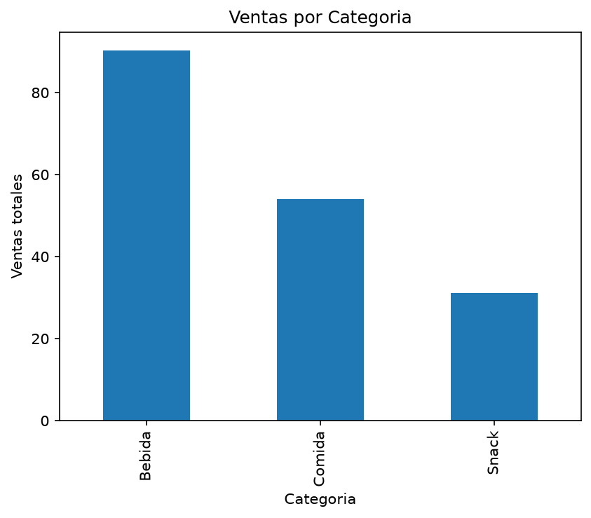
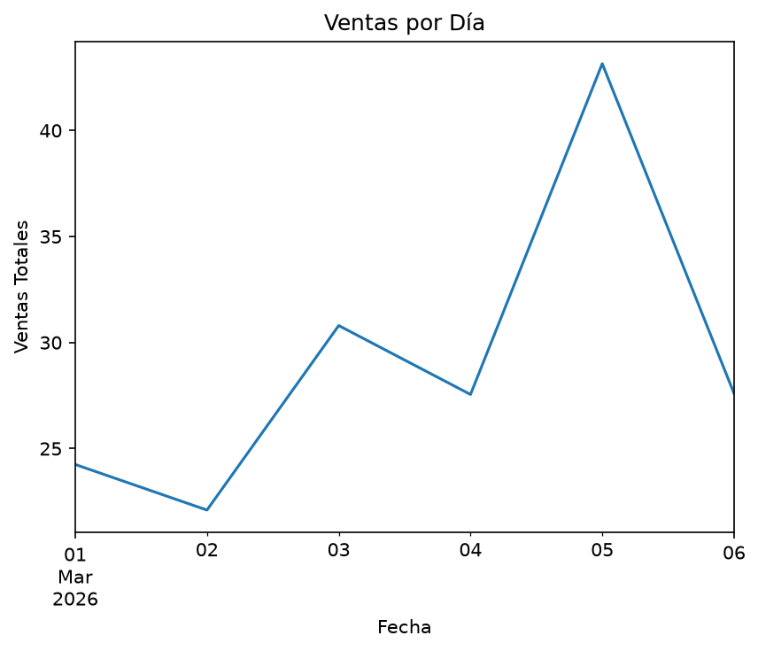

# Cafe Sales Analysis

   Exploratory sales analysis of a café dataset using Pandas and Matplotlib: sales by category, sales by day, and the relationship between both.

   Análisis exploratorio de las ventas de una cafetería con Pandas y Matplotlib: ventas por categoría, ventas por día y la relación entre ambas. Práctica del Diplomado de Business Analytics y Data Science.

   ## Datos
   Archivo CSV de ventas de una cafetería, provisto en el diplomado (`data/cafeteria.csv`).
   Columnas utilizadas: `fecha`, `categoria`, `cantidad`, `precio_unitario`.
   El periodo cubierto es del 1 al 6 de marzo de 2026, con 30 registros.

   ## Métodos
   - Carga y preparación de los datos con Pandas (conversión de fechas).
   - Cálculo de la columna `Total` (cantidad × precio unitario).
   - Gráfica de barras ordenada con las ventas por categoría.
   - Gráfica de línea con las ventas por día.
   - Resumen de ventas por día usando índices y una tabla de unidades vendidas por categoría y fecha.

   ## Resultados
   - La categoría que más vende es **bebidas**.
   - El día de mayor venta fue el **5 de marzo de 2026**.
   - Las bebidas se mantienen como la categoría más vendida todos los días; en snacks hay una ligera tendencia al aumento hacia los últimos días y en comida la demanda fluctúa.

   

   

   ## Cómo ejecutarlo
   1. Clona o descarga este repositorio.
   2. Instala las dependencias: `pip install -r requirements.txt`
   3. Abre `notebooks/cafe_sales_analysis.ipynb` con Jupyter Notebook y ejecuta las celdas en orden (**Kernel → Restart & Run All**).

   ## Estructura
   - `data/`: archivo CSV con los datos.
   - `notebooks/`: notebook con el análisis.
   - `images/`: gráficas generadas por el notebook.
   - `requirements.txt`: dependencias de Python.

   ## Autora
   Melissa Beltrán · Universidad de Panamá